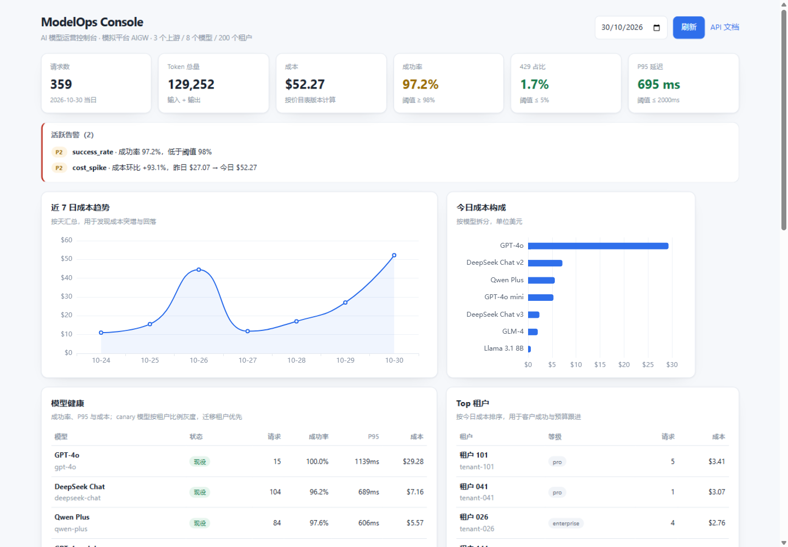
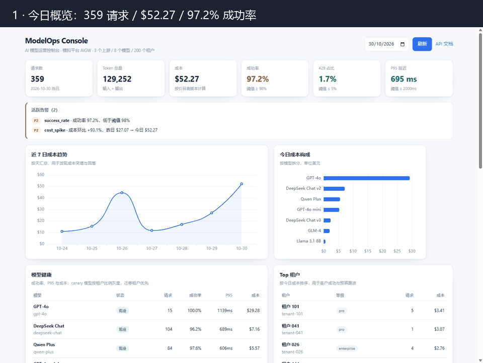

# ModelOps Console

> 一个学生做的 AI 模型运营模拟平台：模型全生命周期、网关计量、成本看板、租户迁移、事件闭环。

[](https://github.com/Scarecrowemm/modelops-console/actions/workflows/ci.yml)






> GIF 演示：今日概览 → 模型健康（v3 灰度 10%）→ 生命周期与迁移。

## 先说清楚

- **这是个人项目，不是生产系统。** 它跑在我自己的笔记本上，用来练习 AI 模型运营的日常工作。
- **上游是 mock，数据是模拟的。** 3 个模拟供应商、8 个模型、200 个模拟租户、1,000 条回放请求；质量分也是模拟值。
- **但流程是真的。** 网关鉴权、限流、路由、fallback、token 计量、版本化定价、生命周期门槛、迁移跟踪、事件闭环、日报生成，都是能跑、能测、能追问的代码。
- 我做它的原因：准备 **AI 模型运营 / AI 网关运营** 岗位，想把 JD 里的四件事跑一遍，而不是只背“了解大模型”。

## 10 分钟看什么

| 想看什么 | 打开 |
|---|---|
| 运营看板长什么样 | 跑起来后打开 `/dashboard`，或看上面的截图 |
| 一份真实的运营日报 | [`docs/daily-report-sample.md`](docs/daily-report-sample.md) |
| 模型评估怎么做 | [`docs/evaluation-report.md`](docs/evaluation-report.md) |
| 生命周期门槛 | [`app/lifecycle.py`](app/lifecycle.py) + 看板“模型生命周期” |
| 迁移计划 | [`docs/migration-plan.md`](docs/migration-plan.md) |
| 事件闭环 | [`docs/runbook.md`](docs/runbook.md)、[`docs/postmortem-sample.md`](docs/postmortem-sample.md) |
| 和 JD 怎么对应 | [`docs/jd-mapping.md`](docs/jd-mapping.md) |
| 我为什么这么设计 | [`docs/design-decisions.md`](docs/design-decisions.md) |
| 我踩过的坑 | [`docs/learning-notes.md`](docs/learning-notes.md) |

## 它做了什么

| 模块 | 具体能力 |
|---|---|
| 网关 | OpenAI 兼容 `/v1/chat/completions`；按 Key 识别租户；RPM/TPM 限流；直连 / canary 比例分流 / 迁移路由 / 失败 fallback；token 计量；按**版本化价目表**算成本；支持 **SSE 流式** |
| 真实上游（可选） | 配置 `MODELOPS_REAL_*` 后启用 `real-chat`，走任意 OpenAI 兼容接口（Ollama/硅基流动/…）；默认关闭 |
| 限流（可选） | 默认进程内固定窗口；设置 `MODELOPS_REDIS_URL` 后切 Redis，Redis 不可用时自动回退 |
| 生命周期 | `tracking → evaluating → approved → canary → active → deprecating → offline`，每个流转有门槛，不满足返回 409 和逐项检查 |
| 评估 | 20 条 prompt（客服/摘要/代码/翻译/长文），质量、通过率、P95、每千次成本、综合得分；低于质量线不推荐；可选 **LLM-as-judge** |
| 迁移 | 40 个租户按 5%/20%/50%/100% 分批；网关按迁移表路由；支持批次完成/回滚 |
| 事件 | 5 类模板（429、超时、成本、质量、密钥）+ Runbook + 复盘样例 |
| 看板 | 6 个 KPI、7 日成本趋势、成本构成、模型健康、Top 租户、生命周期、迁移进度、待生效变更、未闭环事件 |
| 告警 | 成功率、429、P95、成本环比、免费额度；可落库，支持飞书/企业微信/邮件/Webhook |
| 报告 | 日报/周报自动生成 |
| 自动化 | 一键 bootstrap、每日任务脚本、GitHub Actions 每日跑一次并上传报告 |
| 测试 | 32 个测试：定价、限流、生命周期、canary、网关（含流式）、告警、judge、Redis 回退、成本对账 |

## 它没做什么

- 向量/Embeddings 接口
- JWT/OAuth/RBAC、Key 哈希存储
- 多副本部署（Redis 限流是一个可选示例，不是生产集群）
- 真实支付/账单、供应商账单对账
- 多区域、数据保留/归档
- 自动扩缩容、K8s

这些不是“忘了”，是刻意留给下一版。一个 3 周的 MVP 做不完，我也不想假装做完。

## 怎么跑

```bash
python -m venv .venv
.venv\Scripts\pip install -r requirements.txt      # Windows
# source .venv/bin/activate && pip install -r requirements.txt  # macOS/Linux

# 一键：建库 + 回放 1,000 条 + 评估 + 日报
.venv\Scripts\python scripts\bootstrap.py

# 启动
.venv\Scripts\python -m uvicorn app.main:app --host 127.0.0.1 --port 8080
```

打开 <http://127.0.0.1:8080/dashboard>。

> 看板默认看“今天”。如果第二天打开发现是空的，跑一次 `scripts/bootstrap.py` 或 `scripts/daily_job.py --no-replay` 即可。

## 每天跑一次（可选）

```bash
# 追加 200 条模拟请求 + 扫描告警 + canary 检查 + 写日报
python scripts/daily_job.py --count 200
```

GitHub Actions 里也配了一个每日任务（`.github/workflows/daily.yml`），每天 08:00（北京时间）跑一次，把日报作为 artifact 上传。它不会改仓库，只是证明“这个模拟平台可以按天运营”。

## 架构

```
Client
  │  OpenAI-compatible /v1/chat/completions
  ▼
Gateway ── auth ── rate limit ── route ── fallback ── metering
  │                                        │
  ├── mock provider A (OpenAI)             ├── SQLite: requests / evaluations /
  ├── mock provider B (Domestic)           │           migrations / incidents / lifecycle
  └── mock provider C (Self-hosted)        │
                                           ▼
                              Dashboard (ECharts) + Reports (Markdown)
```

**生产化替换点**：

| 组件 | Demo | 生产 |
|---|---|---|
| 上游 | mock | `httpx` 调真实供应商 |
| 存储 | SQLite | PostgreSQL / ClickHouse |
| 限流 | 进程内固定窗口 | Redis + 滑动窗口 |
| 看板 | 单页 ECharts | Vue/React + 指标平台 |
| 质量评估 | 模拟分 | rubric + LLM-as-judge |

## 目录

```
modelops-console/
├── app/
│   ├── gateway.py         # 鉴权、限流、路由、fallback、计量
│   ├── providers.py       # mock 上游
│   ├── pricing.py         # 版本化价格与成本
│   ├── lifecycle.py       # 生命周期状态机
│   ├── evaluation.py      # 评估
│   ├── migration.py       # 迁移批次
│   ├── alerts.py          # 告警计算/落库/通知
│   ├── incidents.py       # 事件闭环
│   ├── metrics.py         # 看板指标
│   └── reports.py         # 日报/周报
├── dashboard/index.html   # 运营看板
├── scripts/
│   ├── bootstrap.py       # 一键初始化
│   ├── daily_job.py       # 每日任务
│   ├── replay.py          # 回放 + 对账
│   ├── canary_check.py    # canary 自动升降级
│   └── real_smoke.py      # 真实模型冒烟（可选）
├── docs/                  # 模型卡、Runbook、迁移计划、RACI、复盘、JD 对应
├── tests/                 # 27 个测试
└── .github/workflows/     # CI + 每日任务
```

## API

| 方法 | 路径 | 用途 |
|---|---|---|
| POST | `/v1/chat/completions` | OpenAI 兼容调用 |
| GET | `/v1/models` | 模型列表 |
| GET | `/api/dashboard?day=YYYY-MM-DD` | 看板数据 |
| POST | `/api/models/{id}/transition` | 生命周期流转（admin） |
| POST | `/api/evaluations/run` | 跑评估（admin） |
| POST | `/api/migrations/plan` | 生成迁移计划（admin） |
| POST | `/api/incidents` | 开事件（admin） |
| POST | `/api/reports/daily` | 生成日报（admin） |

管理接口需要 `X-Admin-Token: admin-demo`（可用 `MODELOPS_ADMIN_TOKEN` 覆盖；公开 demo 请换掉）。

## 测试

```bash
python -m pytest -q
# 32 passed
```

覆盖：版本化定价、RPM/TPM、生命周期门槛、canary 升降级、网关鉴权/迁移/fallback/429、**SSE 流式**、告警落库去重、**LLM-as-judge**、**Redis 回退**、回放成本对账。

## 设计取舍

见 [`docs/design-decisions.md`](docs/design-decisions.md)。一句话总结：

> 我优先做“能讲清楚运营流程”的部分，而不是“看起来像大厂系统”的部分。mock 上游、SQLite、单页看板都是刻意的取舍。

## 我学到了什么

见 [`docs/learning-notes.md`](docs/learning-notes.md)。几个印象最深的点：

- 成本异常往往不是单价变了，而是**请求结构变了**（长上下文占比上升）。
- 429 风暴里，先要区分“平台限流”和“上游限流”，否则会越限越乱。
- 迁移最难的不是切流量，是**通知、回滚和账单核对**。
- 生命周期门槛如果不写成代码，就会变成“口头通过”。

## Roadmap

- [x] 流式响应（SSE）
- [x] 真实供应商 adapter（OpenAI 兼容 / Ollama）
- [x] Redis 限流（可选）
- [x] LLM-as-judge（可选）
- [x] 告警飞书/企业微信/邮件
- [ ] 供应商账单对账
- [ ] 多区域与供应商 SLA 记分卡
- [ ] 压测与容量规划

## License

MIT
